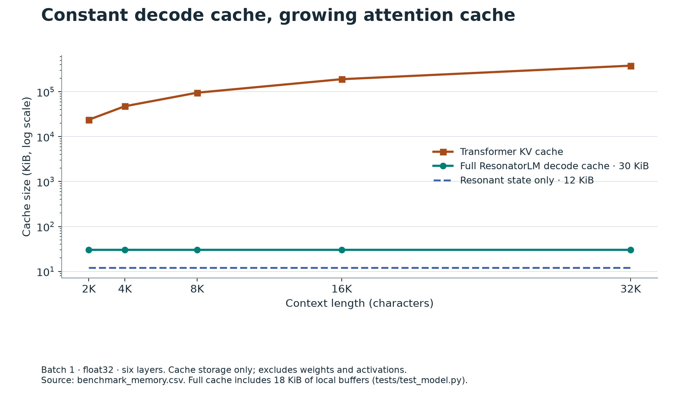
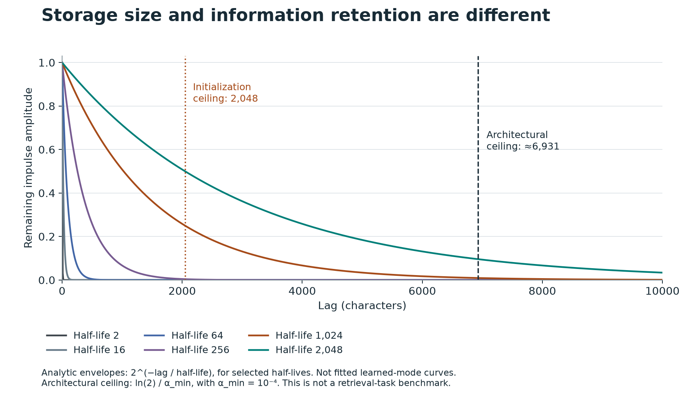

# Recorded results

[Back to the repository](../README.md) · [Reproduction guide](../docs/REPRODUCTION_GUIDE.md)

These are committed records of existing runs, not new experiments performed during the repository reorganization. Training uses seed 0 and 2,000 steps unless an artifact indicates otherwise.

| Artifact | Producer | What it records |
|:--|:--|:--|
| [primary/results.csv](primary/results.csv) · [JSONL](primary/results.jsonl) | `src.train` | ResonatorLM and learned-position Transformer primary training evaluations |
| [rope_audit/results.csv](rope_audit/results.csv) · [JSONL](rope_audit/results.jsonl) | `src.train` | RoPE Transformer control |
| [context_sweep_results.csv](context_sweep_results.csv) | `scripts.eval_context_sweep` | Separate evaluation pass at 256, 512, 1024; the README table's source |
| [benchmark_latency.csv](benchmark_latency.csv) | `src.benchmark` | Local mixer/attention latency measurements; not whole-model L4 speedups |
| [benchmark_memory.csv](benchmark_memory.csv) | `src.benchmark` | Analytical Transformer KV-cache and resonant-state sizes |
| [half_life_decay_audit.csv](half_life_decay_audit.csv) | `src.synthetic_retrieval` | Analytic impulse-envelope amplitudes by half-life and distance |
| [smoke/results.csv](smoke/results.csv) · [JSONL](smoke/results.jsonl) | `src.train` | Short pipeline checks; not headline scientific results |
| [figures/](figures/) | `scripts.generate_plots` | Context comparison, cache scaling, and analytic decay plots |

## Read the measurements correctly

- The primary and context-sweep passes have slightly different metrics. Compare like with like; the README uses only the sweep CSV.
- One seed does not supply a confidence interval or establish statistical superiority. The multi-seed orchestrator is available in `scripts/run_reproduction.py`; its presence does not mean a full study has been completed.
- The memory CSV's `res_state_kib` column is **12 KiB of resonant state**, excluding the local ring buffers. The full batch-1 float32 decode cache is **30 KiB**, verified in [test_model.py](../tests/test_model.py). The figure shows both.
- Constant cache size describes storage scaling, not unlimited information retention. The decay plot describes individual linear modes; it is not a trained retrieval-task result.
- Corpus and checkpoints are gitignored. The CSVs permit inspection of the recorded results; checkpoint-dependent evaluation requires retraining.

